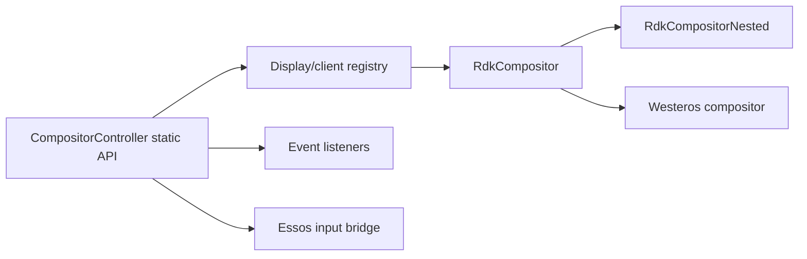
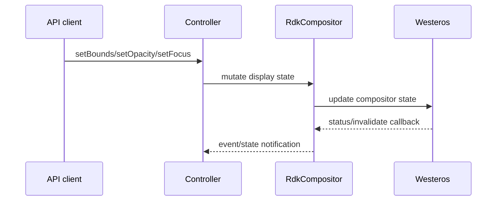
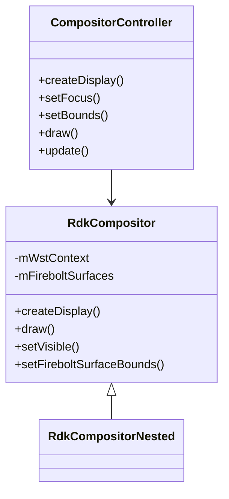
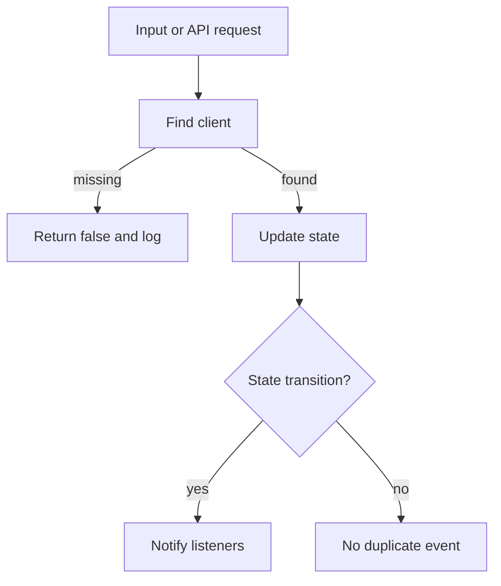

# Compositor and Window Control

## 1. High-Level Purpose & Architecture

### Role in ENT / RDK infrastructure
This subsystem turns public window-management operations into per-display composition state backed by Westeros. It is the control plane for applications, focus, z-order, visibility, geometry, and Firebolt surfaces.

### Responsibilities
- Maintain display/client lookup and `ClientInfo` state.
- Create and coordinate `RdkCompositor` instances.
- Route key and pointer input, including intercepts, listeners, injection, and repeats.
- Emit lifecycle, focus, visibility, and extension events.
- Manage crop, scale, opacity, hole-punch, virtual display, and screenshot operations.

### App Alias Reassignment
`CompositorController::setAlias` transfers an app alias to the newly registered
display under the alias-map lock. An old display may still exist during restart
cleanup, but it no longer resolves through that app ID. This keeps SkyApps
geometry and SkyShell lookup aligned with the current instance rather than
whichever old instance sorts first in the map. Cleanup of the old display does
not remove the new display's alias.

### Interacting subsystems and what it does not do
`CompositorController` delegates display mechanics to `RdkCompositor` and input acquisition to `EssosInstance`. Direct Westeros calls belong in `src/rdkcompositor*.cpp`; the controller does not own the wire protocol implementation.

## 2. Architectural Overview



## 3. Code Organization (Folder & File-Level)

- `include/compositorcontroller.h`, `src/compositorcontroller.cpp`: static public control surface, registries, event routing, and orchestration.
- `include/rdkcompositor.h`, `src/rdkcompositor.cpp`: common compositor state, callbacks, rendering, application lifecycle, and Firebolt surface collection.
- `include/rdkcompositornested.h`, `src/rdkcompositornested.cpp`: nested Westeros implementation.
- `include/rdkwindowmanagerevents.h`: listener contracts.
- `include/rdkwindowmanagerrect.h`: rectangle value type used by hole-punch APIs.

`ClientInfo` contains bounds, scale, opacity, z-order, visibility, crop, and owner ID. `FireboltSurfaceInfo` contains analogous surface-level state plus type and name.

## 4. Class & Interface Documentation

`CompositorController` is a static facade. Major method groups are display creation, focus/z-order, geometry, input registration, event registration, rendering, Firebolt surface operations, and optional VNC/splash controls.

`RdkCompositor` owns one display context. Its lifecycle includes construction, `createDisplay`, callback-driven updates, drawing, and destruction. Its members include a Westeros handle, natural and logical dimensions, transform state, listener maps protected by mutexes, application state, and a vector of Firebolt surfaces.

Representative declaration:

```cpp
static bool setBounds(const std::string& client, const uint32_t x,
    const uint32_t y, const uint32_t width, const uint32_t height);
static bool setFocus(const std::string& client);
static bool draw();
```

Source: [include/compositorcontroller.h](../../include/compositorcontroller.h).

The base class requires derived classes to implement `createDisplay`; its event callbacks are static adapters that forward into instance methods.

## 5. Configuration & Build Integration

The shared library always includes both compositor source files and links `-lwesteros_compositor`, `-lwayland-client`, and `-lessos`. Build definitions gate key metadata, hidden support, forced resolution, animation, external surface composition, key bubbling, key repeats, transparent background, and ERM.

The default Westeros plugin directory is `/usr/lib/plugins/westeros/`, unless `RDK_WINDOW_MANAGER_WESTEROS_PLUGIN_FOLDER` is supplied. Additional extension loading can be configured with `RDK_WINDOW_MANAGER_ADDITIONAL_EXTENSIONS_CONFIG`.

## 6. Internal Workflows & Execution Flow

1. `createDisplay` constructs and initializes a compositor for a client/display.
2. Status and invalidate callbacks update application/display state.
3. Controller methods locate the client and mutate compositor state.
4. Input callbacks are converted to events and routed according to focus, intercept, listener, and propagation rules.
5. `draw` orders displays/surfaces, applies transforms and crop, and handles hole-punch/render paths.
6. Shutdown closes applications and destroys compositor handles.

The code tracks natural render size separately from logical reported size. The semantic contract for display bounds versus render bounds is not fully documented outside comments in `rdkcompositor.h`.

Repeated `setZorder` requests for the current layer are silent no-ops. Only actual
layer changes produce z-order transition diagnostics, including when player and
subtitle layering is refreshed every frame.

### Notification Focus Restoration

Showing an EPG notification temporarily blurs the focused application and
focuses the notification compositor. Hiding or destroying that notification
must blur the notification compositor and focus the saved application again,
not just restore `gFocusedCompositor`. `fireboltSurfaceDestroy` now restores
both compositor focus flags, allowing the existing focus listeners to deliver
SkyShell Active to the application without a Home-button retry.

An explicit `setFocus` cancels the saved notification restore, including a
request for the already-focused app. Hiding or destroying the old notification
then preserves current focus without an artificial blur/active pair. A pending
restore is applied only while its notification still owns focus and its saved
target remains in the live compositor list. This prevents voice-button release
from replaying stale app focus after EPG has selected another app.

Notification input-focus changes use the non-application-notifying compositor
focus setter. SkyShell state and keyboard routing still follow the overlay,
but modal show/restore does not emit ordinary app focus/blur notifications to
ASAppManager. The foreground status and launch history therefore keep the
underlying app rather than briefly marking EPG VISIBLE on a voice-button press.
An explicit focus request for the overlay owner commits a real app-focus event.

The boot failure capture shows monarch becoming Active at 14:56:32.75, then
Inactive when EPG notification surface 6 opens. At 14:56:43.495 that surface is
destroyed, but the old pointer-only restoration leaves monarch inactive. The
native player-surface regression reproduces this show/destroy sequence and
checks both applications' focused flags before continuing the caption tests.

### AS Player and Subtitle Ownership

`configurePlayerSurface` validates and caches each GUI client's main/secondary
player configuration, including `subtitlesMuted`. Configuration requests from a
background client do not directly mutate the active player's compositor.
`getPlayerSurfaceConfig` returns that client's cached request, not another
owner's effective geometry.

`setFocus` selects an automatic player owner. `takeAutomaticPlayerOwnership`
ignores background clients and preserves explicit EPG ownership established by
`takePlayerOwnership`. `releasePlayerOwnership` removes the client's cached
configuration and falls back to the automatic owner when available; `kill`
performs the same cleanup. The main and secondary owners are independent.

Before each `draw`, `updatePlayerSurfaces` snapshots the ownership/configuration
state and applies it to the predefined `westeros-asplayer-0` and
`westeros-asplayer-1` displays. The main player's output rectangle is transformed
from its owner's natural coordinate space into that owner's current logical
viewport. The `westeros-asplayer-subtitles` compositor receives the same output
position, scale and opacity without resizing the subtitle renderer's output.

Player configuration also controls caption layering. When `zorder <= 0`,
video and captions sit just below the owner's GUI, with captions immediately
above video. Opaque GUI content therefore covers captions instead of letting
the fixed z=1000 subtitle display leak through Home. When `zorder > 0`, video
sits at the top of the app pass and captions enter the overlay pass, after
the hardware-video hole punch. Watermark and notification overlays remain
above them. Native regression checks cover both layer modes as well as resize.
Configuration logs report visibility, requested z-order, mute and textured-video
flags only when those fields change, allowing device captures to distinguish
explicit mute requests from captions covered by GUI content.

Captions are hidden if the owner/configuration is absent, the owner or video is
hidden or transparent, the output geometry is empty, or `subtitlesMuted` is set.
Secondary-player mute state does not affect the main subtitle compositor.
`getSubtitlesMuted` exposes the effective state under the player-state mutex.
The SkySubtitles extension reads it on its own Wayland event loop and emits an
initial mute/unmute event followed only by state transitions. Compositor hiding
remains authoritative even if a renderer ignores those protocol hints.

This flow controls presentation, not playback lifetime: headless Rialto daemon
apps keep running and do not need a GUI display or synthetic focus changes.

### Playback Initialization Boundary

The 2026-11-11 playback failure capture has a separate launch prerequisite
failure: VIPA requests the `rialto` capability, but its generated container has
an empty `mRialtoSocketPath` and skips the Rialto socket bind mount. The captured
runtime creates a Rialto connector and reports the default Rialto override,
but never logs daemon session setup. Later, VIPA reports
`opencdm_create_system() FAILED` and cannot create the Rialto video, audio or
subtitle sinks. Caption mute hints cannot repair those initialization failures.

Deploy RuntimeManager's existing headless-daemon Rialto setup as well as the
window-manager changes, with `RIALTO_SUPPORT=ON`. The current `Run` path allows
`isDaemonApp` to create a session without an app-owned display, targets
`/tmp/westeros-asplayer-0`, waits for ACTIVE, and passes a nonempty
`mRialtoSocketPath` to container generation. Verify those setup logs and the
mounted socket in a newly launched VIPA container. Inside that container's
actual runtime/library environment, check `gst-inspect-1.0 rialtomsevideosink`,
`rialtomseaudiosink` and `rialtotexttracksink`, and verify DRM system creation.
Missing sink factories or DRM access need media-runtime/image investigation;
the archives do not establish that correcting the socket alone fixes them.

## 7. Diagrams & Visual Aids







## 8. Testing & Quality Analysis

Public controller behavior is covered primarily through `tests/testrdkwm.cpp` and mocks/L1 tests. The extension suites exercise related surface and client behavior. Recommended gaps are negative tests for missing clients, duplicate visibility/focus events, z-order ties, listener removal during callbacks, and concurrent listener-map access.

## 9. Beginner-to-Expert Teaching Mode

### Must know first
Learn the distinction between a client/display, a compositor instance, and a Firebolt surface. Start with `ClientInfo`, `RdkCompositor`, then the controller facade.

### Advanced learning path
Trace key bubbling and propagation through `onKeyPress`, then study direct versus FBO rendering and hole-punch rectangle preparation. Verify lock scope before changing callback or listener behavior.

### Missing or ambiguous
The meaning of the overlay z-order threshold used by hole-punch rendering and the exact event ordering across all Westeros statuses are implementation details not defined by the public interface.
